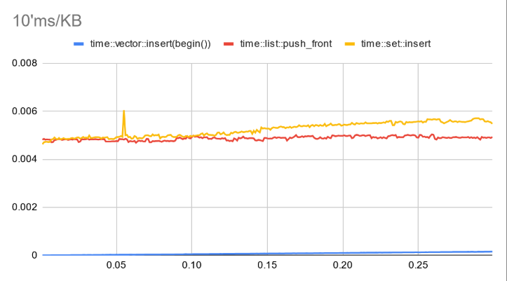
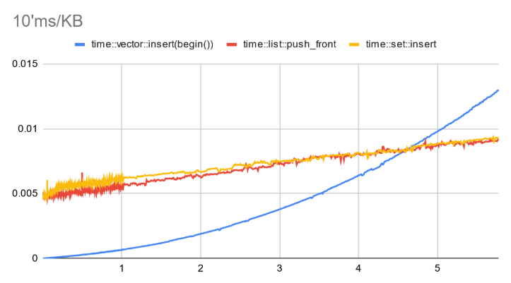
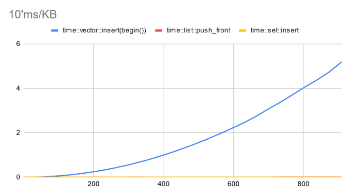
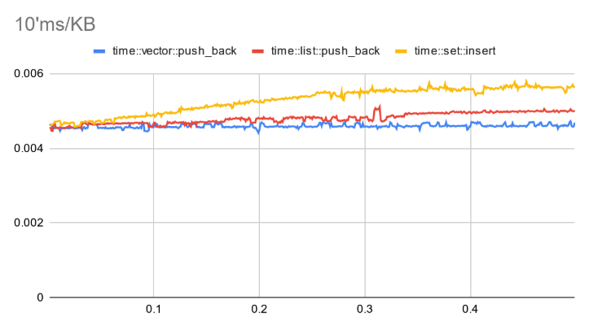
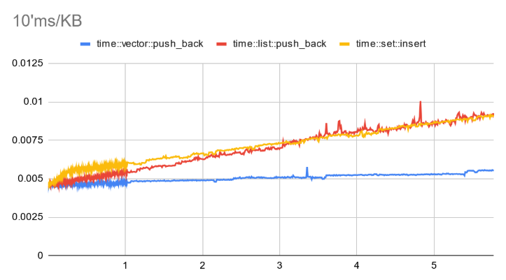
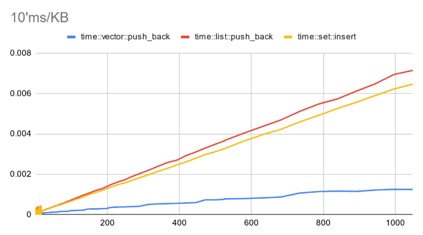

# Плюсове и минуси на динамичния масив

Преди да започнем с това **„що е то списък?“**, нека си припомним какво знаем за досега разгледаните линейни структури от данни.

## Добрите страни

- **Последователност в паметта** – ако елемент $i$ се намира на адрес $x$, то елемент $i+1$ се намира на адрес $x + \text{sizeof}(T)$.
- **Индексация в константно време** – $O(1)$.
- **Добра локалност** – елементите са разположени един след друг.
- **Бърза итерация**.

## Минусите на динамичния масив

Досега разгледахме многото добри качества на динамичния масив, но въпреки това той не е **„супер структура“** и за жалост има своите минуси.

### 1. Премахване на произволен елемент

Като за начало можем да кажем, че не е много лесно да премахнем елемент на произволна позиция. За целта имаме следните опции:

| Подход | Сложност | Проблем |
|---|:---:|---|
| Поставяме последния елемент на мястото на премахвания | $O(1)$ | Нарушава реда на елементите в масива |
| Маркираме елемента като премахнат | $O(1)$ | Допълнителна памет за маркерите и проверки при всеки достъп |
| Отместваме с една позиция назад всички елементи след премахвания | $O(n)$ | Линейно време в най-лошия случай |

1. **Разместване с последния елемент** – води до премахване за константно време, но нарушава правилото масивът да има строго определен ред!
2. **Маркиране като премахнат** – отново операция в константно време, но ще имаме нужда от допълнителна памет, за да маркираме елементите, и допълнителна логика за проверки при всеки достъп. Като цяло много сложен и безполезен подход.
3. **Отместване назад** – на практика е много бърза операция поради пространствената локалност на масива и запазва реда на елементите. Обаче отнема линейно време в най-лошия случай.

### 2. Memory overhead

Динамичният масив също така заделя **overhead** памет. Дори един празен `std::vector` заема някакво количество памет (което зависи от имплементацията на стандартната библиотека и системата, която използвате), което понякога не е желан ефект!

### 3. Паралелна обработка

Още един минус е паралелната обработка на масиви. Ако задачата, върху която работите, е **embarrassingly parallel** – т.е. данните, които обработвате, са независими и не си пречат при паралелна обработка (пример – rendering), тогава нямате проблеми.

Ако обаче просто искате да обработвате паралелно масив, ще имате нужда от синхронизация на действията – една нишка ще работи върху данните и ще възпира останалите, което е ужасно неудобно!

### 4. Инвалидация на итераторите

При преоразмеряване началото на масива в паметта (може да) се промени, което инвалидира итераторите, тъй като адресите на всички елементи се променят.

## Извод

След това кратко обобщение на динамичния масив можем да си направим извода, че той е може би най-добрата структура от данни, ако ще добавяме последователно елементи в края и няма постоянно да премахваме елементи на произволни позиции.

Обаче ние няма да спрем дотук. Сега ще разгледаме една структура от данни, която ще реши повечето от недостатъците на динамичния масив.

---

# Едносвързан списък

Това е следващата линейна структура от данни, която ще разгледаме. По поведение тя много прилича на свързаната реализация на опашка, която разгледахме в предишното упражнение, но с малко повече **екстри**.

### Обобщение на операциите

| Операция | Метод | Сложност |
|---|---|:---:|
| Добавяне в началото | `pushFront()` | $O(1)$ |
| Добавяне в края | `pushBack()` | $O(1)$ |
| Добавяне след итератор/елемент | `pushAt()` | $O(1)$ |
| Премахване в началото | `popFront()` | $O(1)$ |
| Премахване след елемент | `popAfter()` | $O(1)$ |
| Премахване в края | `popBack()` | $O(n)$ |
| Първи елемент | `front()` | $O(1)$ |
| Последен елемент | `back()` | $O(1)$ |
| Произволен елемент | `at()` | $O(n)$ |

Нека разгледаме операциите по-подробно.

## Добавяне

### В началото – `pushFront()` · $O(1)$

При тази операция силата на свързания списък започва да се проявява при голям брой елементи. На графиките по-долу се вижда, че докато елементите са малко (до около 4 KB), достъпът до L1 кеша успява да компенсира бавната линейна операция `pushFront` при вектора. Но малко преди 5 KB добавянето на елемент в списъка (при теста няма алокация – елементите са предварително заделени) става по-бързо от преместването във вектора.

  
  
  

<i>Източник: Любомир Коев</i>

### В края – `pushBack()` · $O(1)$

Тук историята е друга. Колкото и много елементи да добавим, списъкът не може да бие добавянето на елемент в края на масив без алокация. Ако имаше алокация от време на време, щяха да се получават артефакти във времето, но при много елементи това е пренебрежимо!

  
  
  

<i>Източник: Любомир Коев</i>

### След итератор/елемент – `pushAt()` · $O(1)$

Тук резултатът ще бъде същият като при добавяне в началото, тъй като за списъка това е просто обновяване на няколко указателя, а за масива – преместване на потенциално всички елементи.

> [!NOTE]
> Условието е вече да имаме итератора, след който добавяме, тъй като обхождането на списък е бавна операция, както предстои да видим.

## Премахване

- **В началото** – `popFront()` · $O(1)$
- **След елемент** – `popAfter()` · $O(1)$
- **В края** – `popBack()` · $O(n)$

> [!WARNING]
> Премахването в края изисква достъп до предпоследния елемент, за да бъде запазен инвариантът на списъка. Това означава, че тази операция не е характерна за едносвързания списък и я добавяме само за пълнота.

## Достъп до елемент

- **Първи елемент** – `front()` · $O(1)$
- **Последен елемент** – `back()` · $O(1)$
- **Посочен** – `at()` · $O(n)$

Ако се търси конкретен елемент (което е изцяло нехарактерно за свързан списък), сложността е линейна, тъй като трябва да се обходи списъкът, докато се намери търсеният елемент.

## Обхождане

Много е удобно чрез **ForwardIterator**. Позволява ни паралелен достъп, тъй като обновяването на списъка не инвалидира итератора, но е и бавно поради постоянните скокове в паметта.

## Сливане

Може да стане за константно време, ако залепим единия списък след другия. В противен случай е линейно спрямо дължината на двата списъка, тъй като създаваме нов (резултатен) списък, който ще върнем.

## Сортиране

Можем да сортираме свързан списък **in-place** (без допълнителна памет) чрез **merge sort** за време $O(n \log n)$.

## Извод

Нека видим какво точно спечелихме със свързания списък и дали не ви измамих, като обещах, че в него се крие решението на проблемите на динамичния масив.

### Ползи

- Премахване за константно време в началото или след итератор.
- Подлежи на лесна паралелна обработка.
- Сливане на два списъка за константно време.
- Операциите за добавяне са с константна сложност.
- Празният списък заема константна памет, равна на големината на двата указателя, които пази (`head`, `tail`).
- Нямаме инвалидация на итераторите при премахване и добавяне на нови елементи.

### Какво не ни харесва

- Нямаме ефективно премахване в края.
- Липсва индексация.
- Плащаме линейна допълнителна памет заради указателите – особено осезаемо, ако типът ни е малък по размер.
- Всички действия са в една посока.
- Винаги трябва да имаме предшестващ елемент.

## Практически приложения на свързаните списъци

Свързаните списъци са едни от най-използваните структури от данни поради удобното добавяне и премахване на елементи за константно време.

Ето някои от по-популярните им приложения:

- **Memory allocators** – например arena-based алокатори.
- **Виртуална памет** – абстракция на паметта на компютъра, при която физическата памет може да бъде RAM или вторична памет.
- **Кеш предиктори**.

---

## Задачи за упражнение

### По-лесни задачи

| № | Задача |
|:---:|---|
| 1 | [Merge Two Sorted Lists](https://leetcode.com/problems/merge-two-sorted-lists/description/?envType=problem-list-v2&envId=linked-list) |
| 2 | [Remove Duplicates from Sorted List](https://leetcode.com/problems/remove-duplicates-from-sorted-list/description/?envType=problem-list-v2&envId=linked-list) |
| 3 | [Linked List Cycle](https://leetcode.com/problems/linked-list-cycle/description/?envType=problem-list-v2&envId=linked-list) |
| 3*| [Find the Duplicate Number](https://leetcode.com/problems/find-the-duplicate-number/description/)|
| 4 | [Intersection of Two Linked Lists](https://leetcode.com/problems/intersection-of-two-linked-lists/description/?envType=problem-list-v2&envId=linked-list) |
| 5 | [Remove Linked List Elements](https://leetcode.com/problems/remove-linked-list-elements/description/?envType=problem-list-v2&envId=linked-list) |
| 6 | [Reverse Linked List](https://leetcode.com/problems/reverse-linked-list/description/?envType=problem-list-v2&envId=linked-list) |
| 7 | [Palindrome Linked List](https://leetcode.com/problems/palindrome-linked-list/description/?envType=problem-list-v2&envId=linked-list) |
| 8 | [Middle of the Linked List](https://leetcode.com/problems/middle-of-the-linked-list/description/?envType=problem-list-v2&envId=linked-list) |
| 9 | [Convert Binary Number in a Linked List to Integer](https://leetcode.com/problems/convert-binary-number-in-a-linked-list-to-integer/description/?envType=problem-list-v2&envId=linked-list) |

### Малко по-сложни задачи

| № | Задача |
|:---:|---|
| 10 | [Minimum Pair Removal to Sort Array I](https://leetcode.com/problems/minimum-pair-removal-to-sort-array-i/description/?envType=problem-list-v2&envId=linked-list) |
| 11 | [Add Two Numbers](https://leetcode.com/problems/add-two-numbers/description/?envType=problem-list-v2&envId=linked-list) |
| 12 | [Remove Nth Node From End of List](https://leetcode.com/problems/remove-nth-node-from-end-of-list/description/?envType=problem-list-v2&envId=linked-list) |
| 13 | [Remove Duplicates from Sorted List II](https://leetcode.com/problems/remove-duplicates-from-sorted-list-ii/description/?envType=problem-list-v2&envId=linked-list) |
| 14 | [Reverse Linked List II](https://leetcode.com/problems/reverse-linked-list-ii/description/?envType=problem-list-v2&envId=linked-list) |
| 15 | [Rotate List](https://leetcode.com/problems/rotate-list/description/?envType=problem-list-v2&envId=linked-list) |
| 16 | [Sort List](https://leetcode.com/problems/sort-list/description/?envType=problem-list-v2&envId=linked-list) |
| 17 | [Rotate List](https://leetcode.com/problems/rotate-list/description/?envType=problem-list-v2&envId=linked-list) |
| 18 | [Delete Node in a Linked List](https://leetcode.com/problems/delete-node-in-a-linked-list/description/?envType=problem-list-v2&envId=linked-list) |
| 19 | [Odd Even Linked List](https://leetcode.com/problems/odd-even-linked-list/description/?envType=problem-list-v2&envId=linked-list) |
| 20 | [\*Split Linked List in Parts](https://leetcode.com/problems/split-linked-list-in-parts/description/?envType=problem-list-v2&envId=linked-list) |
| 21 | [Remove Zero Sum Consecutive Nodes from Linked List](https://leetcode.com/problems/remove-zero-sum-consecutive-nodes-from-linked-list/description/?envType=problem-list-v2&envId=linked-list) |
| 22 | [Merge In Between Linked Lists](https://leetcode.com/problems/merge-in-between-linked-lists/description/?envType=problem-list-v2&envId=linked-list) |
| 23 | [Swapping Nodes in a Linked List](https://leetcode.com/problems/swapping-nodes-in-a-linked-list/description/?envType=problem-list-v2&envId=linked-list) |
| 24 | [Maximum Twin Sum of a Linked List](https://leetcode.com/problems/maximum-twin-sum-of-a-linked-list/description/?envType=problem-list-v2&envId=linked-list) |
| 25 | [Double a Number Represented as a Linked List](https://leetcode.com/problems/double-a-number-represented-as-a-linked-list/description/?envType=problem-list-v2&envId=linked-list) |
