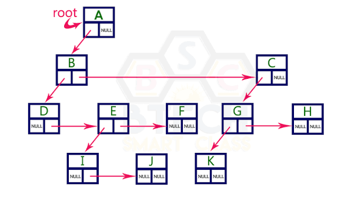

## Увод

Вече знаете, че свързаните списъци са крайно неоптимални в задачи, където основната операция е **търсене на елемент по ключ**. Силата им е другаде: в добавянето, премахването и пренареждането на елементи.

При **последователната реализация** на списък (динамичен масив) ситуацията е подобна, но наобратно. Добавянето и премахването, когато не са в края, имат линейна сложност. Търсенето пък може да се сведе до логаритмично чрез двоично търсене, но само ако масивът е сортиран, а поддържането на подредбата прави добавянето и премахването изцяло линейни.

| Структура            | Добавяне / премахване | Търсене      |
|----------------------|:---------------------:|:------------:|
| Свързан списък       | `O(1)`                | `O(n)`       |
| Сортиран масив      | `O(n)`                | `O(log n)`*  |

И в двата случая плащаме висока цена. Има ли как да имаме **хем бързо добавяне и премахване, хем бързо търсене**?

> **Отговорът е да!** Нека видим как.

## Дървета

Ще разгледаме **дървовидни структури от данни**, които съчетават бързото добавяне и премахване на свързаната реализация с ефективното търсене на последователната.

Преди това нека въведем терминологията, която ще използваме занапред.

### Основни понятия

| Термин         | Дефиниция |
|----------------|-----------|
| Дърво          | Свързан ацикличен граф. Между всеки два възела има точно един път, а при `n` възела има точно `n − 1` ребра. |
| Възел          | Основният елемент на дървото. Съдържа стойност и връзки към децата си. |
| Корен          | Избран възел, който няма родител. От него започва обхождането на дървото. |
| Кореново дърво | Дърво с избран корен. Така всяко ребро получава посока: от родител към дете. |
| Поддърво       | Даден възел заедно с всички негови наследници. |

### Видове възли

| Термин         | Дефиниция |
|----------------|-----------|
| Вътрешен възел | Възел, който има поне едно дете. |
| Листо          | Възел без деца. |
| Братя          | Възли с общ родител. |

### Характеристики

| Термин         | Дефиниция |
|----------------|-----------|
| Разклоненост*  | Броят деца на даден възел. Разклонеността на дървото е максималната сред всички възли. |
| Ниво           | Всички възли на едно и също разстояние от корена. Коренът е на ниво 0. |
| Дълбочина      | За възел: броят ребра по пътя от корена до него. |
| Височина       | За възел: броят ребра в най-дългия път от него до листо. Височината на дървото е височината на корена, т.е. максималната дълбочина. |
| Тегло          | Броят възли в дървото или поддървото. |

> **\* Забележка: разклоненост**
>
> В практиката се срещат дървета с различна разклоненост:
>
> | Разклоненост | Пример                                                  |
> |:------------:|---------------------------------------------------------|
> | 2            | Двоични дървета (предстои да ги разгледаме)             |
> | 4            | Квадрантни дървета (quadtree): деление на равнина       |
> | 8            | Октантни дървета (octree): деление на тримерно пространство |
> | 16           | Цифрите в шестнадесетичната бройна система              |
> | 26           | Буквите от английската азбука (префиксни дървета)       |
> | 256          | Всички стойности на един байт                           |
> | стотици до хиляди | B-дървета (бази данни, файлови системи)            |

## Представяне на дървета

### Свързано представяне

Всеки родител пази директни връзки към децата си. Недостатъкът е паметта: листата нямат деца, но пак плащат цената за указателите.

Има няколко начина да се пазят връзките към децата:

```cpp
// 1. Чрез отделни указатели (фиксиран брой деца)
struct node_ptr
{
    Type      data;
    node_ptr *ch1, *ch2, *ch3; // ...
};

// 2. Чрез статичен масив (k - максималната разклоненост)
struct node_arr
{
    Type      data;
    node_arr *children[k];
};

// 3. Чрез динамичен масив
struct node_vector
{
    Type                 data;
    vector<node_vector*> children;
};

// 4. Чрез свързан списък
struct node_list
{
    Type                data;
    llist<node_list*>   children;
};
```

Сравнение на последните два варианта (`k` е броят деца на възела):

| Критерий               | `vector`                                   | `llist`                                         |
|------------------------|--------------------------------------------|-------------------------------------------------|
| Достъп до i-тото дете  | `O(1)`                                     | `O(k)`                                          |
| Вмъкване на дете       | `O(k)` (в края: амортизирано `O(1)`)       | `O(1)` (при известна позиция)                   |
| Локалност              | Добра: указателите са последователно в паметта | Лоша: всяка клетка е на различно място       |
| Допълнителна памет     | Резервиран, но неизползван капацитет       | Допълнителни указатели във всяка клетка         |

### Последователно представяне

Ако дървото е **гъсто** и **максималната му височина е известна предварително**, всички възли може да се заделят наведнъж в масив. Децата на всеки възел се пазят едно до друго, а втори масив указва откъде започват. Така всеки възел знае само къде са децата му и колко са на брой.

Подходът е разточителен откъм памет, защото заделя място за пълно дърво. В замяна цялата информация е последователна в паметта и обхождането е много бързо.

```cpp
class tree
{
    struct node
    {
        int firstChild
        int count;
    };

    // пълно двоично дърво с височина height има 2^height - 1 възела
    static const int MAX_NODES = (1 << height) - 1;

    node elements[MAX_NODES]; // всички възли, децата на един възел са съседни
    int  indexes[MAX_NODES];  // indexes[i] - индекс на първото дете на i-тия възел

public:
    // ...
};
```

> [!NOTE]
> Лично съм използвал този подход за реализация на **ускоряващо дърво** ([Bounding Volume Hierarchy](https://en.wikipedia.org/wiki/Bounding_volume_hierarchy)). Това е дърво от паралелепипеди, успоредни на координатните оси, които обгръщат триъгълниците в сцената. Целта е да се намали броят проверки дали даден лъч пресича триъгълник. Ако ви е интересно, вижте това [видео](https://www.youtube.com/watch?v=C1H4zIiCOaI).

### Родителско представяне

Всеки възел помни само **родителя си**. Ако пазим масив с всички листа, спестяваме памет, защото всеки възел има само един указател.

Недостатъкът е, че нямаме директен достъп до децата. За да премахнем вътрешен възел, трябва да намерим и пренасочим всичките му деца, а за това се налага да обходим цялото дърво.

```cpp
class tree
{
    struct node
    {
        Type  data;
        node* parent;
    };

    vector<node*> leaves; // от тях се стига до всеки възел, вървейки нагоре

public:
    // ...
};
```
## LCRS дърво (Left-Child Right-Sibling)

Известен факт от дискретната математика е, че **всяко подредено дърво с произволна разклоненост може да се представи еднозначно като двоично дърво**. Това е много полезно за нас като програмисти, тъй като можем да представим дървета с произволна разклоненост като двоични.

<div align="center">
  
</div>

### Структура на възела

Всеки възел има точно два указателя, независимо колко деца има:

```cpp
struct node
{
    Type  data;
    node* left;  // първото дете
    node* right; // следващият брат
};
```

Така Децата на всеки възел образуват **едносвързан списък**, който можем да обходим линейно. Коренът също е специален случай понеже дървото има само един корен, той **няма братя** и неговият `right` винаги е `nullptr`.

| Предимства                                       | Недостатъци                                        |
|--------------------------------------------------|----------------------------------------------------|
| Еднаква памет за всеки възел (два указателя)     | Достъпът до i-тото дете е `O(i)`, а не `O(1)`      |
| Няма неизползвани указатели, както при масив от деца | Няма директна връзка към родителя               |
| Може да се ползват алгоритмите за двоични дървета |                                                   |

----

### Премахване на елемент

Премахването на възел не е съвсем интуитивна операция. Разглеждаме три отделни случая:

1. **Възелът няма деца** - указателят, който сочи към него се пренасочва към следващия му брат.
2. **Възелът има деца и има следващ брат** - децата на възела се прехвърлят на следващия брат и свеждаме до първата стъпка.
3. **Възелът има деца и няма следващ брат** - указателят, който сочи към възела, се пренасочва към първото му дете.

> [!IMPORTANT]
> И в трите случая трябва да знаем **кой указател сочи към премахвания възел**. Понеже нямаме връзка към родителя, е нужно да го намерим при спускането от корена, т.е. докато вървим по пътя до възела, пазим предишния.

### Добавяне на елемент

Тук **няма естествена подредба**, която да определи къде отива новият елемент. Затова мястото трябва да се зададе изрично, например чрез **път от корена**: поредица от индекси на деца.

> Пример: пътят `[2, 0]` означава „третото дете на корена, после неговото първо дете“.

## Обхождане на дървета

### Обхождане в ширина (BFS)

Обхождането в ширина (Breadth-First Search) посещава възлите **поетажно**: първо корена, после всички възли на ниво 1, после на ниво 2 и т.н. За целта използва **опашка**: възлите се обработват в реда, в който са открити.

```cpp
struct node
{
    Type          data;
    vector<node*> children;
};

void bfs(node* root)
{
    if (!root) return;

    queue<node*> nodes;
    nodes.push(root);
    nodes.push(nullptr); // маркер за края на нивото

    while (true)
    {
        node* current = nodes.front();
        nodes.pop();

        if (!current)
        {
            cout << '\n';             // край на текущото ниво
            if (nodes.empty()) break; // няма повече нива
            nodes.push(nullptr);      // маркер за края на следващото ниво
        }
        else
        {
            cout << current->data << ' '; // обработка на възела

            for (node* child : current->children)
                nodes.push(child);
        }
    }
}
```

> [!NOTE]
> Маркерът `nullptr` е нужен само ако искаме да знаем **къде свършва всяко ниво** (например за отпечатване по редове или за изчисляване на височината). Ако това не ни интересува, достатъчно е да вадим възли, докато опашката не се изпразни.

### Обхождане в дълбочина (DFS)

Обхождането в дълбочина (Depth-First Search) тръгва от корена и **се спуска възможно най-надолу** по един клон, преди да се върне и да опита следващия. За целта използва **стек**: явен или неявен чрез рекурсия.

Според това кога обработваме възела спрямо децата му, различаваме два вида:

| Вид                    | Ред                                  | Приложение (пример)                     |
|------------------------|--------------------------------------|-----------------------------------------|
| **Pre-order** (преди)  | Първо възела, после децата           | Копиране на дърво, отпечатване на йерархия |
| **Post-order** (след)  | Първо децата, после възела           | Изтриване на дърво, изчисляване на размер |

```cpp
void dfs_preorder(node* root)
{
    if (!root) return;

    cout << root->data << ' '; // обработка ПРЕДИ децата

    for (node* child : root->children)
        dfs_preorder(child);
}

void dfs_postorder(node* root)
{
    if (!root) return;

    for (node* child : root->children)
        dfs_postorder(child);

    cout << root->data << ' '; // обработка СЛЕД децата
}
```

### Сравнение

|                          | BFS                         | DFS                          |
|--------------------------|-----------------------------|------------------------------|
| Структура                | Опашка                      | Стек (или рекурсия)          |
| Ред на обхождане         | Ниво по ниво                | Клон по клон                 |
| Време                    | `O(n)`                      | `O(n)`                       |
| Допълнителна памет       | `O(w)`, `w` е най-широкото ниво | `O(h)`, `h` е височината |
| Подходящо за             | Най-близкия възел до корена | Обработка на цели поддървета |


### Източници

* **[LcRs wikipedia](https://en.wikipedia.org/wiki/Left-child_right-sibling_binary_tree)**
* **[Програмиране = ++Алгоритми; (Глава 2.2)](https://www.programirane.org/wp-content/uploads/downloads/2015/09/Programirane=++Algoritmi-v2015.pdf)**
